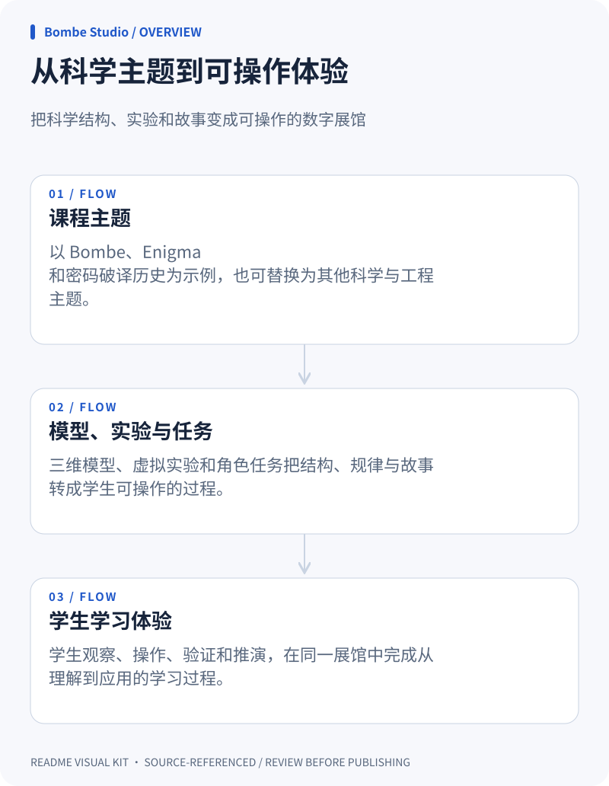
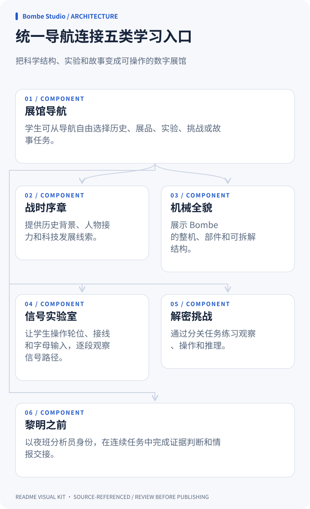
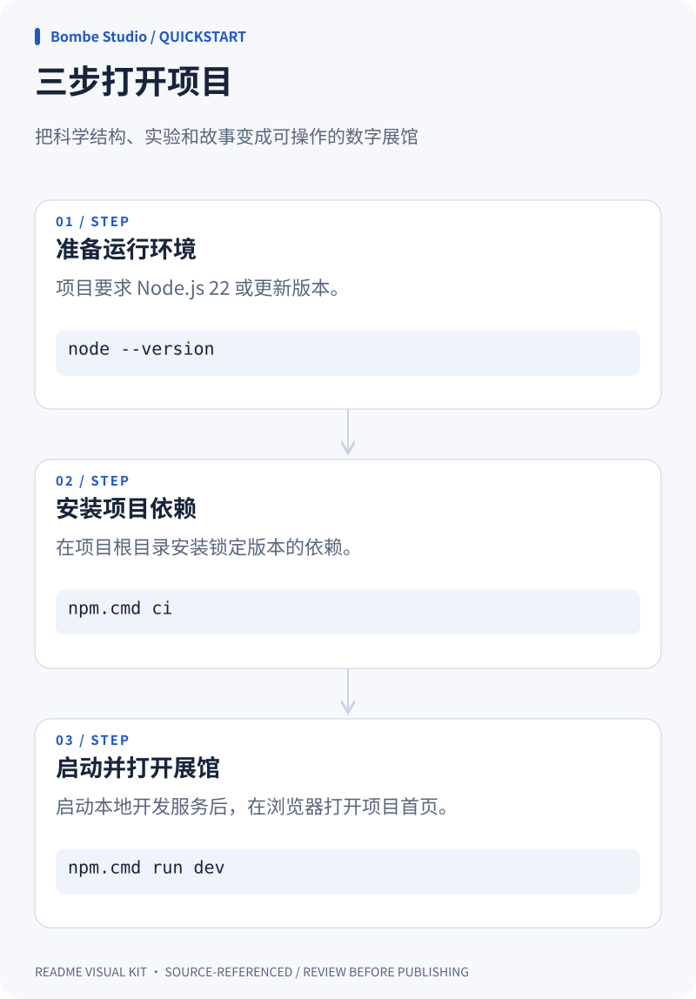

# Bombe Studio · 面向科学教育的互动数字展馆



## 项目简介

Bombe Studio 是一个面向科学教育的互动数字展馆项目。它把复杂的机械结构、抽象的科学原理和具有时代背景的探索故事，转化为学生可以在电脑上直接观察、操作和推演的学习体验。

项目以 Bombe、Enigma 和密码破译历史为示例，形成四类可按课程主题定制的数字教育产品：

### 1. 定制 3D 模型

按课程主题制作可交互的三维立体模型。学生可以在电脑上放大、旋转模型，拆开外部结构，查看内部部件之间的关系，再通过操作控件恢复和操控模型。

以 Bombe 为例，学生可以观察机架、鼓轮阵列、机械传动、接线板和电机等系统，理解一个复杂设备如何由多个部分共同工作。相同方式也可以用于机械、工程、生物结构和其他需要空间理解的课程。

### 2. 互动科普程序

把抽象理论转化为可以亲手完成的数字化任务。学生可以在虚拟实验中调整条件、输入信息、观察过程和比较结果，直观理解科学规律如何产生。

项目中的信号实验室将 Enigma 的转子、反射器、接线和信号路径变成可操作实验。学生可以调整轮位、接入线路、输入字母，并逐段追踪信号，看到设置变化如何影响输出。

### 3. 角色扮演与故事推演程序

结合课程内容设置任务情境，让学生化身科学家、工程师、分析员等角色，在电脑上完成操作、判断和闯关。

“黎明之前”让学生以夜班分析员身份推进一条连续任务链：接收信息、比对档案、分析线索、设置机器、检查候选结果并完成情报交接。学生通过证据和反馈推进故事，体验提出假设、验证关系和修正结论的过程。

### 4. 定制博物馆程序

围绕课程主题打造专属虚拟展馆。学生可以在展馆中自由漫游，在时间线、人物、展品和互动任务之间切换，沉浸式了解一个科技领域的发展历程。

当前项目包含“战时序章、机械全貌、信号实验室、解密挑战、黎明之前”五个入口。它们把历史背景、三维展品、虚拟实验和故事任务放在同一条参观路径上，可用于课堂导入、主题教学、分组探究和课后自主学习。

## 使用方式

### 学生使用

1. 打开项目首页，从“战时序章”了解主题背景和发展线索。
2. 进入“机械全貌”，放大、旋转并拆解三维模型，观察内部构造。
3. 进入“信号实验室”，调整轮位和接线，输入字母并逐段追踪信号。
4. 进入“解密挑战”，完成由观察、操作和推理组成的六个任务。
5. 进入“黎明之前”，在角色任务中综合使用前面学到的知识完成故事推演。

### 教师使用

- 课堂导入：先让学生自由观察展品，再提出需要验证的问题。
- 原理讲解：使用虚拟实验演示部件关系、信号变化和条件影响。
- 分组探究：让学生分别完成挑战任务，记录操作、结果和判断依据。
- 情境教学：以角色任务组织协作，讨论证据如何支持一个科学结论。
- 课后延伸：开放展馆和实验室，让学生重复操作并比较不同设置。

### 访问入口

| 入口 | 适合的学习活动 |
| --- | --- |
| `#/history` | 了解历史背景、人物接力与科技发展历程 |
| `#/` | 观察 Bombe 整机和主要系统 |
| `#/lab/drums` | 体验转子、反射器与信号路径 |
| `#/lab/wiring` | 观察接线板和字母互换关系 |
| `#/challenge` | 完成六关互动科普任务 |
| `#/mission` | 在故事情境中完成连续推理与交接 |

### 本地运行

项目使用电脑浏览器访问，完整体验建议使用带鼠标的电脑。需要 Node.js 22 或更新版本：

```powershell
npm.cmd ci
npm.cmd run dev
```

打开 `http://127.0.0.1:4173/` 即可进入展馆。项目使用原生 JavaScript、Three.js 和 esbuild，不依赖运行时 CDN、在线字体或外部 API。





## Teardown 版 01–03

01 已替换为 Bombe Atelier：108 个多层鼓轮、36 组三轮组合、五个可独立观察的系统、连续拆解与 56 秒导览。02、03 使用共同的转子剖视模型，提供触点、内部接线、外壳切换、信号逐段播放、隔离与 48 秒导览。

02 与 03 的计算直接复用 `src/cipher.js` 和 `src/challenge-engine.js`：Enigma I 的 I/II/III 转子、反射器 B、环位 AAA、双步进与双向跳线。01 的 26³ 轮位计数为教学示意；整机是照片结构重建，实验台是放大的电路剖视，均不是生产 CAD，也不是完整 Bombe 破译器。

```powershell
npm.cmd ci
npm.cmd run build
npm.cmd test
```

构建输出 `dist/chapters/01.html`、`02.html`、`03.html`，每页约 0.75 MB，Three.js、字体与样式全部内嵌，可单独离线打开。整站通过现有开发服务器或静态托管访问。修改 `chapters/` 后重新执行 `node chapters/build.mjs` 即可更新开发预览。

章节源码位于 `chapters/atelier` 和 `chapters/bench`。父页面只负责导航与生命周期；未展示章节停止动画帧，实验进度在切换章节后保留。独立 Three.js 版本通过构建别名隔离，04、05 使用其现有依赖版本。

Teardown 技能来源：<https://github.com/elvarofficial/teardown>，基于 `a91262ac1109051e014662d42ecb0b7bc1f113b1`。`chapters/kit/warm.js` 保留上游 MIT 许可；完整第三方许可随每个离线 HTML 内嵌。验收清单与结果见 `docs/teardown-qa.md` 和 `docs/teardown-results.md`。

## 视觉说明

仓库中的 `readme-visuals/` 提供项目概览、简化架构和快速开始的明暗主题 SVG，可在离线环境中查看和编辑。图示只用于帮助理解项目入口和学习流程，不替代源码与实际课程设计。
