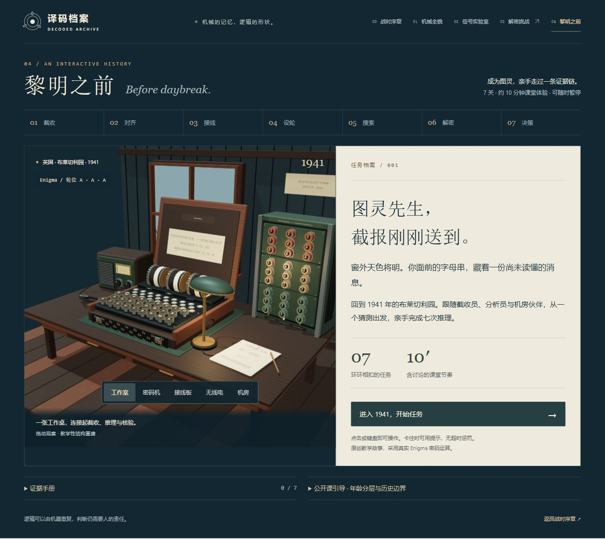

# BOMBE · 译码档案

GitHub 仓库：[judgemeido/bombe-studio](https://github.com/judgemeido/bombe-studio)。这是源代码仓库；网页仍按下方命令在本地运行。

## 01–03 统一视觉与一屏布局（2026-10-19）

整机、信号实验室和六关挑战沿用 00 的深蓝、暖白与黄铜金色系，统一三维材质、卡片和操作控件。正文保持 16px，桌面布局按窗口高度分配模型与控制区；较长的说明在卡片内滚动。实验室采用步骤、模型、键盘三栏，挑战的操作步骤可按需展开，手机保持纵向阅读。

已检查 1024×768、1280×720、1366×768、1440×900 的桌面一屏布局及 390px 手机布局，并复查拆解、实验输入输出与六关通关。159 项测试及构建通过，截图见 `output/playwright/viewport-*.png`。



## 新增 04：黎明之前（2026-10-18）

打开 `http://127.0.0.1:4173/#/mission`，以夜班分析员的视角进入七个行动节点：截收、对齐、接线、设轮、搜索、解密、交接。05:42 的北港短报将在 15 分钟内从频道线索走到交接决定。2026-10-19 细化了木盒合页与卡扣、转子齿圈/刻度/触点、圆形按键与灯板、26 组双插孔、机柜面板与鼓轮紧固件、无线电和桌面材质。五个视角可观察工作室、密码机、接线板、无线电和机房。

入场为约 10 秒的 Three.js 实时镜头与盖板动作，关间为约 2.4 秒过渡；均在同一三维场景内完成，可跳过、暂停或按 Esc 跳过。页面不含视频播放器，也不请求 MP4。减少动态效果模式直接进入任务。

同一条行动线适用于三至九年级及成人；每个节点提供两级提示、深入讨论和证据记录。七个节点预算共 900 秒，包含阅读、操作和交接判断，没有倒计时惩罚。暂停、隐藏页面及章节切换会停止活动；本次页面内进度保留，刷新会重开。

模型、对白、DX 编号与北港交接报文均为原创情境。密码计算使用真实 Enigma I 置换、按键前步进和中轮双步进。第 5 节点是缩小到 26 个起点的枚举实验，不是完整历史 Bombe 搜索复原。全部密文字母参与连续运算，不丢弃猜测起点之前的两格。

实现位于 `src/mission*.js` 与 `mission.css`；旧 Remotion 工程及影片保留为历史创作资料，当前网站不再引用或复制它。主应用保持原生 JavaScript / Three.js / esbuild，运行时无需 React、在线 API 或外部媒体。验证详情见 [04 验收记录](docs/MISSION_04_ACCEPTANCE.md) 和 [模型与实时过渡验收](docs/MISSION_REFINEMENT_ACCEPTANCE.md)。

## 当前首页：18节历史档案（2026-10-18）

默认首页已重做为四段叙事、18个板块的历史长篇：海上通信、波兰突破、Bombe诞生、操作员与情报工作。提供桌面侧边目录、手机可展开目录、人物肖像、教学示意和逐节来源。保留整机、信号实验室及六关挑战。当前工作目录为 `D:\Codex\city\bombe-studio`，运行 `npm.cmd run dev`，访问 `http://127.0.0.1:4173/`。

正文和样式源分别为 `history-preview.html` 与 `history-preview.css`；新章节锚点在 `src/routes.js`。本轮129项测试及构建通过；完整内容、来源差异和浏览器验证范围见 [十八节首页验收记录](docs/HISTORY_18_ACCEPTANCE.md)。下文保留三维产品原有说明。

使用 `three-product-studio` 开发的三章节 3D 展示页。第一章展示二战时期的 **Turing–Welchman Bombe** 机电破译机，第二章用一个可计算的 Enigma 三转子回路解释鼓轮和接线，第三章让小学孩子通过六关解密任务整合知识。Bombe、Enigma 与理论计算模型“图灵机”分别说明。

## 运行

需要 Node.js 22 或更新版本，使用 PowerShell：

```powershell
cd D:\Codex\city\bombe-studio
npm.cmd ci
npm.cmd run dev
```

打开 `http://127.0.0.1:4173`。默认只监听本机。可设置 `$env:PORT = 4174` 更换端口。

章节地址：`#/history` 为历史首页，`#/` 为整机，`#/lab/drums` 为鼓轮与完整回路，`#/lab/wiring` 为放大的接线板，`#/challenge` 为六关解密挑战，`#/mission` 为七关、约 15 分钟的解密游戏。支持直接刷新、浏览器前进后退。顶部五个章节入口均可跳转。

```powershell
npm.cmd test
npm.cmd run build
```

`dist/` 是完整静态发布目录，可交给任意静态托管服务。通过 HTTP 预览，避免直接双击 HTML。项目没有在线字体、远程图片或运行时 CDN 依赖，网页不需要密钥。没有执行公开发布。

## 已实现的体验

- 108 个实例化鼓轮，5 个功能分组，前面阵列与后部接线。
- 连续拆解滑杆、拆合按钮；先轴向抽离，再抬升/分区，接线板最后在空位中翻面。
- 五个独立展位；完全拆解时，正面、斜视、背面均保留部件间的视觉间距。
- 部件目录与模型拾取；标记初始隐藏，选择后显示半透明玻璃标记，重复点击目录或点击空白处取消。
- 可点击展开的结构笔记，包含每个系统的结构组成、观察步骤和关系说明；支持从笔记进入模型。
- 分件总览与单件特写；特写只显示当前部件，“总览”恢复五系统。相机按包围盒适配桌面与手机。
- 正面、斜视、背面，拖动旋转、滚轮缩放、缩放与复位按钮；手动操作可中断自动镜头。
- 鼓轮开始/暂停示意动画；系统减少动态效果时改为立即拆合、逐步转位。
- 展品史料、来源链接、操作指南，原生 dialog 键盘行为。
- 桌面与手机布局、原生 range、焦点样式、快捷键 E / 空格 / R / Esc。
- 第二章包含三只 26 触点鼓轮、字母刻度、内部置换接线、固定后触点、可抽出的端面、B 反射器和 26 插孔接线板。
- 调整三轮位置，点击两个插孔或端点菜单接入一对字母，按键实际计算；逐段、暂停与重播共享九段信号进度，不会再次转位。
- 输入/输出记录、固定轮位互易验证、连续两次 A 的观察任务及接线互换小测。字母键可输入，右方向键逐段，空格播放/暂停。
- 章节间使用淡入幕布、内容位移/模糊入场与上移揭幕；加载条对应导入、建模、材质预热和就绪阶段。支持系统减少动态效果。
- 实验室为一屏布局：模型、输入/输出、播放与九段路径同时可见；轮位/接线、完整指引、记录/验证分别按需打开。默认先准备实验再按 A，当前段及对应部件使用铜色强调，经过的路径弱化。
- 默认显示五步指引：准备 AAA → 输入 A → 手动追踪九段至 B → 再按 A 比较 D → 回到 AAA 接 A↔C 比较 Q。每步说明操作、观察和原因；模型、键盘、结果与信号路径边框加深，当前操作区域额外强调。可切换自由探索；“完整指引”提供全部步骤和术语解释。
- 第三章包含六关：部件识别、接线互换、按键转位、完整路径、固定轮位互易、三字母消息解密。每关提供三步指引、提示、解释和重试，保留可旋转/展开/点击的 3D 模型；末关亲手调轮位、接跳线、逐个输入密文。
- 进入第三章或“换一套题”会生成新种子，按难度分层从题库抽题，组合字母、轮位和接线，并洗牌答案；本地避开最近两套题。最终词库含 20 个三字母词及中文含义，所有回路答案由同一加密算法计算。

模型为程序化教学重建，尺寸和结构包含展示性简化。第二章按 Enigma I–II–III、反射器 B、固定环位 AAA 计算，UI 开放一对接线，包含按键前转位与中轮双步进；它用于讲解置换，不执行完整的 Bombe 菜单搜索或候选设置检查，也不是可制造的工程模型。

## 代码结构与后续扩展

| 文件 | 职责 |
| --- | --- |
| `src/model.js` | 统一尺寸 DIM，部件记录 PARTS，程序化几何、实例化、拆解与运转、资源释放 |
| `src/textures.js` | 本地 Canvas 生成鼓轮刻字、金属铭牌、涂层细节 |
| `src/scene.js` | 相机、OrbitControls、环境反射、主/补/轮廓灯、阴影、响应式构图 |
| `src/framing.js` | 按包围盒八角与深度计算相机距离，预留水平/垂直安全区 |
| `src/main.js` | 整机状态、DOM 控制、部件拾取、章节装配、偏好与生命周期 |
| `src/navigation.js` | Hash 路由、串行转场、真实准备阶段、滚动位置和焦点恢复 |
| `src/lab.js` | 第二章实验状态、原生控件、九段讲解、教学任务和渲染生命周期 |
| `src/lab-template.js` / `lab.css` | 一屏实验台模板、视觉层级、手机布局与原生弹层 |
| `src/lab-walkthrough.js` | 五步操作引导、实际操作反馈、偏离步骤恢复和当前目标边框 |
| `src/lab-model.js` | 教学几何、26 触点、接线拾取、展开结构、动态信号和资源释放 |
| `src/cipher.js` | 无 DOM 的置换、步进、接线与信号追踪算法 |
| `src/challenge-engine.js` | 分层题库、种子随机、参数组合、去重洗牌、答题与末关解密状态机 |
| `src/challenge.js` / `src/challenge-template.js` / `challenge.css` | 第三章 3D 观察台、逐关任务、设置与操作、儿童引导及响应式布局 |
| `src/notes.js` | 总览和五个部件的详细笔记数据 |
| `index.html` / `styles.css` | 档案馆视觉、部件面板、控制台、移动布局和史料弹窗 |
| `tests/model.test.mjs` | 几何边界与数量、拆合不漂移、输入边界、暂停/复位、资源释放 |
| `tests/separation.test.mjs` | 拆解顺序、系统间距、手机/桌面构图与三种总览的投影分离 |
| `tests/cipher.test.mjs` | 参考向量、双步进、九段衔接、互易性及非法输入 |
| `tests/challenge.test.mjs` / `tests/teaching-model.test.mjs` | 批量抽题、唯一答案、重试进度、真实消息解密、教学模型拾取与资源释放 |
| `docs/CODE_QUEST.md` / `CODE_QUEST_QA.md` | 第三章题库算法、教学流程、扩展方式、已验证与待验收范围 |
| `QA.md` | 浏览器验收清单与结果，截图路径 |
| `LAB_GUIDANCE_QA.md` / `LAB_LAYOUT_QA.md` / `LAB_QA.md` / `docs/SIGNAL_LAB.md` | 当前步骤引导验收、历史布局/首版验收、模型与算法边界、教学操作及后续扩展说明 |

以展示单位建模：Y 向上，+Z 为鼓轮正面，主体宽 7.6、高约 6.6、柜深 2.05；这些数值不代表原机实测米制尺寸。部件偏移每帧由原始位置计算，接线板翻转也用同一拆解进度驱动，防止反复拆合累积误差。

模型 API：`root`、`parts`、`setExplode(0…1)`、`setFocus(id | null)`、`update(dt, running)`、`resetMotion()`、`getAnchor(id)`、`getBounds(id?)`、`dispose()`。改造新产品时保留模型与 DOM 状态边界，替换尺寸、部件记录及几何即可。静态几何只在相同部件、相同材质内合并；可分离部件保持独立。共享 GPU 资源仅释放一次。

### 拆解路径与交互状态

拆解进度是唯一几何来源，各段采用 smoothstep，反向拖动严格沿原路径返回：

| 进度区间 | 动作 |
| --- | --- |
| 0–28% | 鼓轮向前、接线板向后抽离，保持横向位置与朝向 |
| 28–62% | 鼓轮抬升，传动从后部退出；40% 后电机从前方抽出 |
| 40–88% | 接线板移向右侧，62% 后空机架移向左侧；两者随后抬高 |
| 62–100% | 传动升高并回到展示深度；接线板在 76% 后绕自身中心翻面 |

最终机架位于左侧，鼓轮在上方，传动在中央，接线在右侧，电机在下方。模型尺寸与展示位移以同一坐标系计算。测试分别检查体积相交和屏幕投影重叠，避免只在一个角度看似分离。

应用状态分开记录目标进度、当前进度、选择、特写对象、视角和相机自动跟随。目录点击会导航，直接拾取保留当前观察位置；特写中的隐藏部件不参与拾取。相机按目标包围盒计算位置，并沿最短方位角绕转，避免切换正背面时穿过展品。详细笔记使用原生 dialog，保留 Esc 和关闭后的焦点恢复；小屏内部滚动时关闭按钮固定在笔记顶部。

无后处理和外部 GLB，优先确保几何、材质和操作的清晰度。浏览器只读诊断：`window.__BOMBE_INSPECT__()`；报告状态、鼓轮数量、绘制调用、三角形、纹理和相机数据，不作为产品控制接口。

第二章诊断为 `window.__BOMBE_LAB__()`，第三章为 `window.__BOMBE_QUEST__()`。整机与实验室保留状态，第三章重新进入时重新抽题；隐藏章停止渲染，第二、三章首次进入时才动态导入。构建使用 ESM 分包，发布时完整保留 `dist/chunks/`。开发服务从内存发布一次成功构建的全部输出，并保留已被打开页面引用的旧哈希分包；加载失败可以返回整机，或刷新模块缓存重新准备。

## 史料依据

查阅日期：2026-10-16。仅参考事实与结构，不下载或复制博物馆图片。

- [The National Museum of Computing — Turing–Welchman Bombe](https://www.tnmoc.org/bombe)：机电破译流程、三个独立 Enigma 电路组、对角板、检查过程。
- [Crypto Museum — Bombe](https://www.cryptomuseum.com/crypto/bombe/)：三组、每组十二组三鼓轮，108 鼓轮与 36 组 Enigma 模拟特征。
- [The Rutherford Journal — The Turing Bombe](https://www.rutherfordjournal.org/article030108.html)：首台 Victory 与改进型 Agnes 的 1940 年时间线、BTM 工程制造和对角板。
- [Crypto Museum — Enigma wiring](https://www.cryptomuseum.com/crypto/enigma/wiring.htm)：I、II、III 的接线、转位缺口与 B 反射器置换。
- [Crypto Museum — Enigma operation](https://www.cryptomuseum.com/crypto/enigma/working.htm)：按键、电流往返、接线互换与转位原理。

建模与页面代码独立编写，没有复制 Cassette 项目代码或其媒体。Three.js 与 esbuild 版本在 package-lock.json 锁定，第三方许可见 `THIRD_PARTY_NOTICES.txt`。
