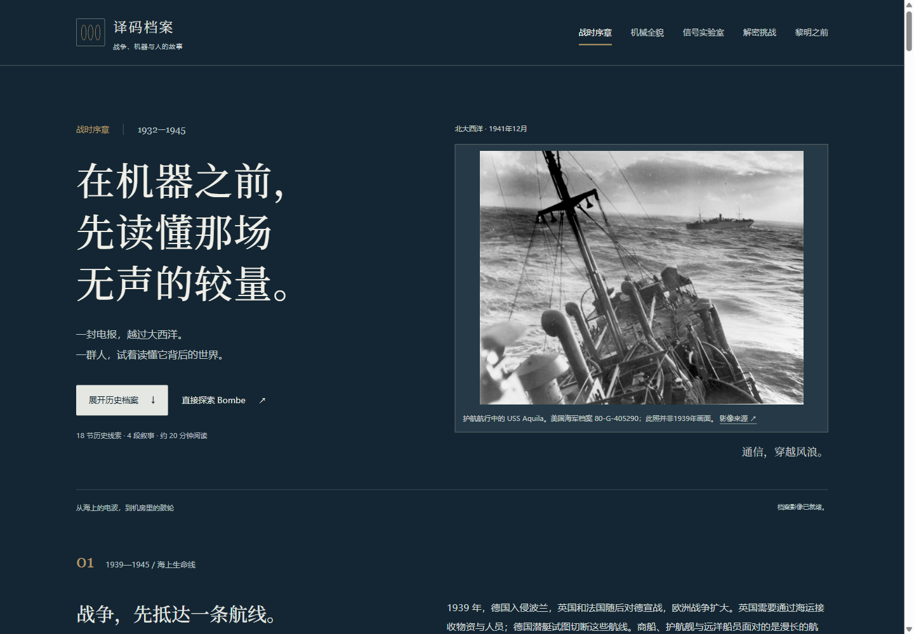
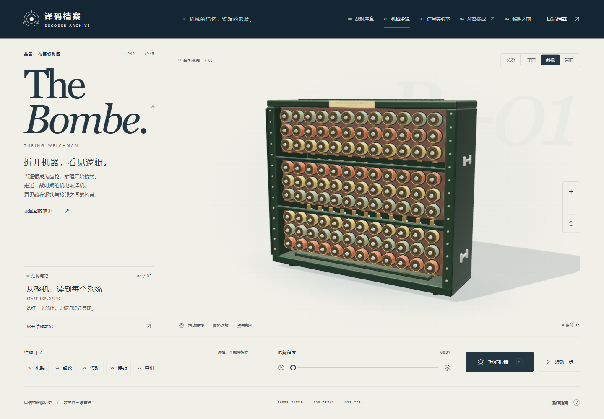
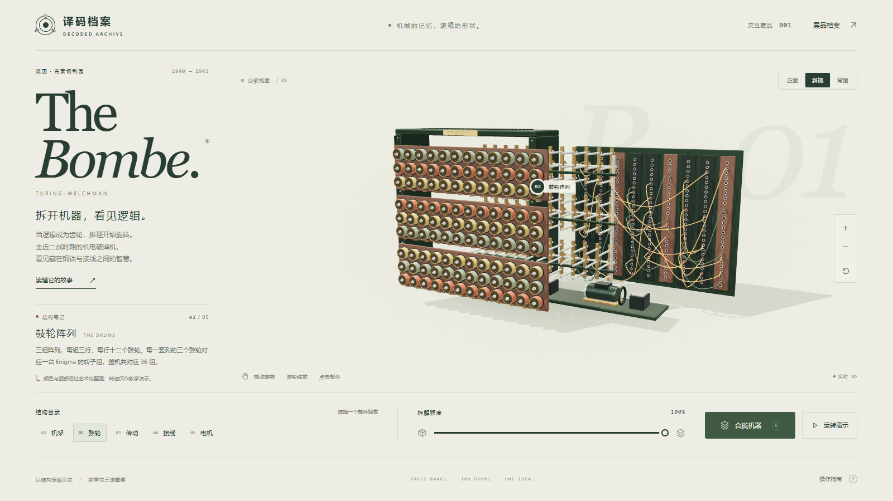
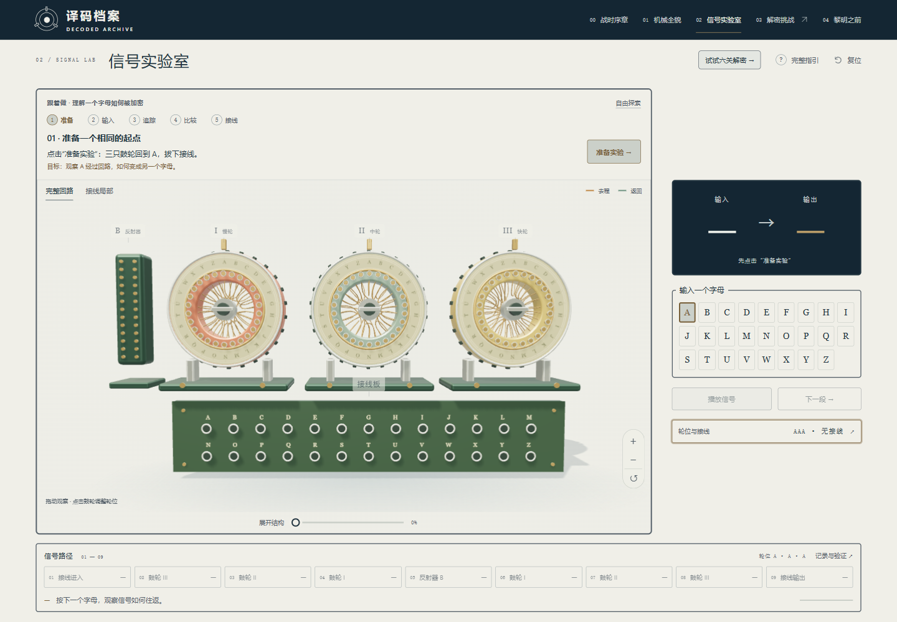
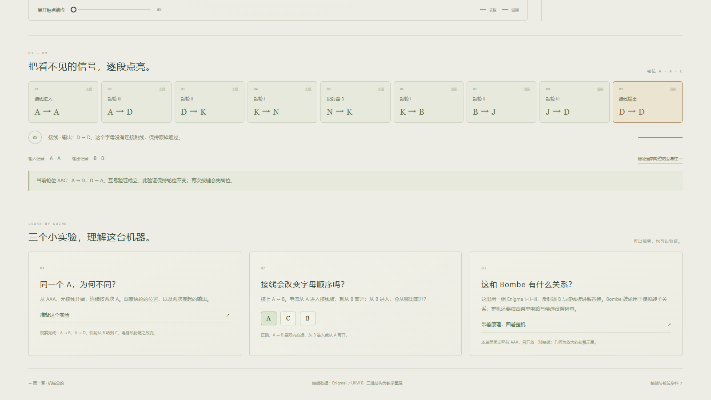
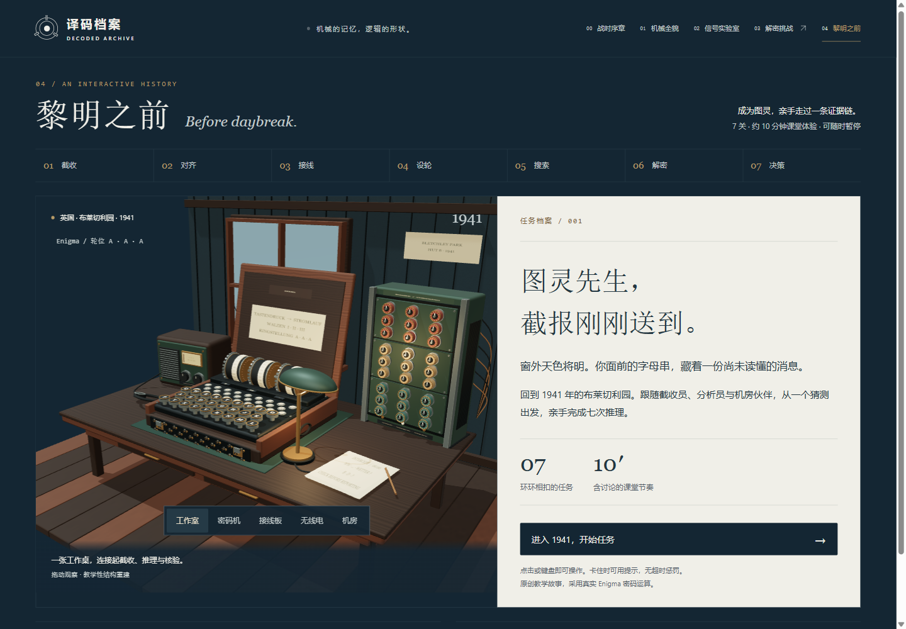

# Bombe Studio 互动展馆使用手册

这是一套电脑端互动展馆。顶部导航对应四个入口：00、01、02、04。

| 入口 | 用途 |
| --- | --- |
| 00 战时序章 | 浏览科技发展历史，查看章节、影像和资料来源 |
| 01 机械全貌 | 观察 Bombe 三维模型，查看部件和内部结构 |
| 02 信号实验室 | 设置鼓轮和接线，输入字母，查看信号路径 |
| 04 黎明之前 | 扮演分析员，完成一组解密任务 |

## 00｜定制博物馆程序

00 页面用来参观历史展馆。内容从海上通信开始，依次介绍密码机、密码分析、Bombe 和后续影响。

使用方法：

1. 点击顶部“00 战时序章”。
2. 向下滚动阅读章节。
3. 点击“阅读目录”，直接跳到指定章节。
4. 点击章节中的“+”，查看补充内容。
5. 点击影像下方的来源链接，查看资料出处。
6. 通过页面中的“01 机械全貌”“02 信号实验室”“04 黎明之前”进入其他程序。

## 01｜定制 3D 模型

01 页面用来查看 Bombe 的结构。模型可以旋转、缩放、切换视角，也可以拆开查看内部部件。

使用方法：

1. 拖动模型，旋转观察。
2. 滚动鼠标，放大或缩小。
3. 点击“总览 / 正面 / 斜视 / 背面”，切换视角。
4. 点击下方“结构目录”，查看机架、鼓轮、传动、接线和电机。
5. 拖动“拆解程度”滑杆，查看内部结构。
6. 点击“运转演示”，查看机器运动。
7. 点击右侧 `+`、`−` 或复位按钮，调整画面。

## 02｜互动科普程序

02 页面用来做信号实验。学生可以设置三个鼓轮，输入一个字母，查看信号经过接线、鼓轮和反射器后的变化。

使用方法：

1. 点击“准备实验”，恢复初始设置。
2. 在右侧键盘点击一个字母。
3. 点击“播放信号”或“下一段”，查看信号的 9 个阶段。
4. 拖动“展开结构”滑杆，查看部件之间的关系。
5. 点击“轮位与接线”，修改鼓轮位置或接线。
6. 点击“接线局部”，查看接线板细节。
7. 点击“复位”，重新开始实验。

## 04｜角色扮演或故事推演程序

04 页面用来完成一组故事任务。学生扮演夜班分析员，按顺序处理截收、对齐、接线、设轮、搜索、解密和决策。

使用方法：

1. 点击顶部“04 黎明之前”。
2. 点击“进入 1941，开始任务”。
3. 按顶部任务条完成七个阶段。
4. 每一关先看任务档案，再操作键盘、接线板、鼓轮或候选结果。
5. 根据页面反馈修改选择，完成当前任务后进入下一关。
6. 完成最后一关，查看交接结果。

## 建议使用顺序

先在 00 了解背景，再到 01 看机器，接着在 02 做实验，最后进入 04 完成任务。

